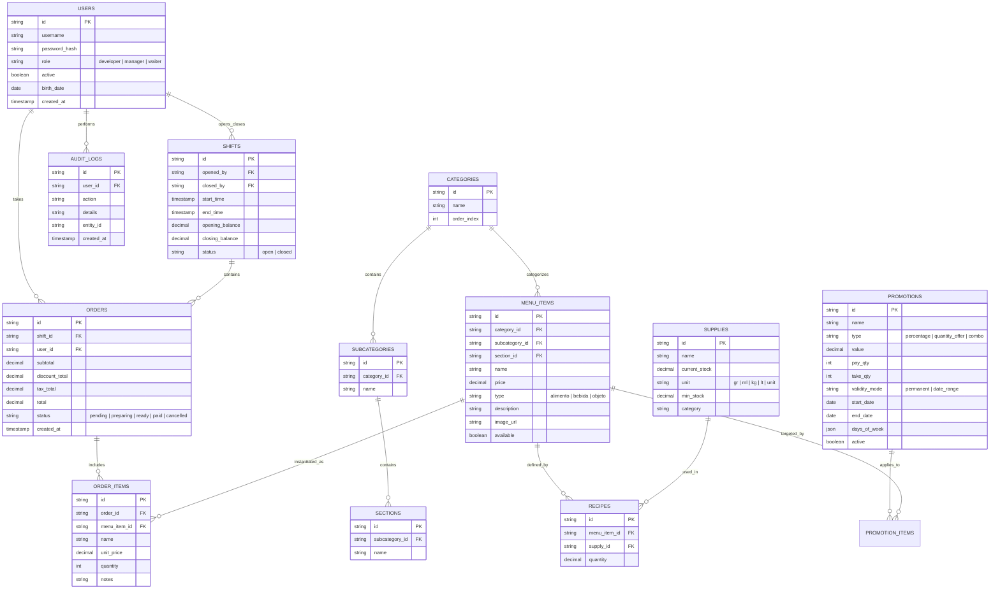

# Especificación Técnica y Arquitectura del Sistema: RestaurantPro

Este documento consolida la arquitectura completa, el catálogo exhaustivo de vistas, las especificaciones funcionales de negocio, el modelo de datos relacional propuesto y el stack tecnológico recomendado para la nueva versión de **RestaurantPro**.

---

## 1. 🎯 Visión General y Filosofía de Arquitectura

**RestaurantPro** es una plataforma integral de **Punto de Venta (POS)** y **Gestión de Recursos (ERP Gastronómico)** diseñada para operar con **autonomía total en red local**, garantizando:
- **Cero dependencia de Internet:** La operación de venta, comandas y bodega no se detiene si la conexión externa falla.
- **Privacidad y Soberanía de Datos:** La información contable, financiera y de clientes reside físicamente en el local comercial.
- **Baja Latencia (< 50 ms):** Respuestas instantáneas en toma de pedidos e interacción táctil.
- **Sincronización Multi-dispositivo:** Comunicación en tiempo real entre la Caja principal, las Tablets de meseros y las Pantallas de Cocina (KDS).

### Topología de Red Física

```
┌─────────────────────────────────────────────────────────────────────────┐
│                           RED WI-FI LOCAL (LAN)                         │
└────────┬────────────────────────────────┬───────────────────────────────┘
         │                                │
         ▼                                ▼
┌────────────────────────┐      ┌────────────────────────┐
│  Tablets de Meseros    │      │ Pantalla Cocina (KDS)  │
│  (Navegador Web / PWA) │      │ (Visualizador Comandas)│
└────────┬───────────────┘      └────────┬───────────────┘
         │                               │
         │  WebSockets (Socket.io) / API │
         └───────────────┬───────────────┘
                         ▼
┌─────────────────────────────────────────────────────────────────────────┐
│                    NODO MAESTRO (Computadora de Caja)                    │
│                                                                         │
│  ┌───────────────────────┐             ┌─────────────────────────────┐  │
│  │ Interfaz de Usuario   │             │ Servidor Backend (Fastify)  │  │
│  │ (React + Vite Desktop)│             │ - API REST                  │  │
│  └───────────┬───────────┘             │ - Motor WebSockets          │  │
│              │                         │ - Driver Impresión ESC/POS  │  │
│              ▼                         └──────────────┬──────────────┘  │
│  ┌───────────────────────┐                            │                 │
│  │ Empaquetador Electron │                            ▼                 │
│  │ (Acceso a Hardware)   │             ┌─────────────────────────────┐  │
│  └───────────┬───────────┘             │ Base de Datos Relacional    │  │
│              │                         │ (PostgreSQL / SQLite WAL)   │  │
│              ▼                         └─────────────────────────────┘  │
│  ┌───────────────────────────────────────────────────┐                  │
│  │ Impresora Térmica de Tickets (USB / Red Ethernet) │                  │
│  └───────────────────────────────────────────────────┘                  │
└─────────────────────────────────────────────────────────────────────────┘
```

---

## 🖥️ 2. Catálogo de Vistas (Pantallas del Sistema)

El sistema cuenta con **14 vistas estructuradas** según el perfil del usuario:

| # | Vista (`View`) | Roles Autorizados | Nombre en Pantalla | Propósito Principal |
| :-: | :--- | :--- | :--- | :--- |
| **1** | `login` | Todos | Acceso al Sistema | Validación de credenciales por usuario y contraseña/PIN. Selección de tema visual inicial. |
| **2** | `dashboard` | Todos | Panel Principal | Menú hub con tarjetas navegables según privilegios. Indicador de estado de turno en vivo. |
| **3** | `setup` | Developer | Asistente de Instalación | Configuración guiada para restaurantes recién implementados (negocio, administrador, datos base). |
| **4** | `menu_ordering` | Meseros, Gerente, Dev | Menú General (POS) | Toma de pedidos, visualización por categorías, carrito en vivo con notas de cocina y cobro. |
| **5** | `menu_editor` | Gerente, Dev | Editor de Menú | CRUD de productos, precios, recetas, fotos, categorías, subcategorías y disponibilidad inmediata. |
| **6** | `inventory` | Gerente, Dev | Control de Insumos | Gestión de existencias en bodega (kg, gr, lt, piezas), umbrales mínimos y alertas de desabasto. |
| **7** | `promotions` | Gerente, Dev | Editor de Promociones | Creación de ofertas de porcentaje, promociones por volumen ($N \times M$), combos y vigencia semanal. |
| **8** | `turno_gestion` | Gerente, Dev | Gestión de Turno | Apertura/cierre de caja, registro de marcas horarias y cálculo de ventas acumuladas por turno. |
| **9** | `gestion` | Gerente, Dev | Gestión de Usuarios | Administración de personal, asignación de roles (`developer`, `manager`, `waiter`) y contraseñas. |
| **10** | `historial` | Todos | Historial de Tickets | Consulta rápida de comandas cobradas y botón de reimpresión de comprobante de pago. |
| **11** | `registro_ventas` | Gerente, Dev | Historial de Ventas | Reporte analítico con filtros por fecha, turno y producto; métricas de recaudación total. |
| **12** | `audit_log` | Gerente, Dev | Registros de Auditoría | Trazabilidad inmutable de más de 27 eventos de seguridad y configuración de qué eventos auditar. |
| **13** | `tax_settings` | Developer | Configuración de Impuestos | Parámetros fiscales (IVA), modo inclusivo vs. exclusivo y métodos de redondeo contable. |
| **14** | `visual_settings` | Todos | Configuración Visual | Ergonomía: escalado de interfaz (80%, 100%, 120%), orientación (horizontal/vertical) y temas. |

---

## ⚙️ 3. Especificación Funcional de Módulos

### Módulo A: Terminal de Punto de Venta (POS) y Comandas
- **Navegación Táctil Ágil:** Filtros inmediatos por Categoría, Subcategoría y Sección.
- **Buscador Reactivo:** Localización por texto predictivo y atajos visuales.
- **Carrito de Pedidos en Vivo:**
  - Control de cantidad y desglose unitario.
  - Notas de comanda por ítem (ej. *"Término medio"*, *"Sin cebolla"*).
  - Cálculo dinámico de subtotal, descuentos por promoción e impuestos.
- **Procesamiento de Venta:** Envío de comanda a cocina, vinculación con el turno abierto y generación de ticket.

### Módulo B: Control de Insumos y Recetas (Inventario Derivado)
- **Catálogo de Insumos Base (`SupplyItem`):**
  - Unidades de medida estandarizadas: gramos (`gr`), mililitros (`ml`), kilogramos (`kg`), litros (`lt`) y piezas (`unit`).
  - Umbral de stock mínimo configurable por insumo.
  - Semáforo visual de existencias: **Normal** (verde), **Bajo** (amarillo) y **Crítico** (rojo).
- **Motor de Recetas vinculadas (`RecipeComponent`):**
  - Cada platillo del menú tiene una receta compuesta por insumos y cantidades.
- **Descuento Automatizado:** Al finalizar una venta, el sistema reduce automáticamente las existencias de cada ingrediente según la cantidad de unidades vendidas.
- **Ajustes Manuales:** Posibilidad de registrar mermas o reabastecimientos con justificación auditada.

### Módulo C: Editor de Menú y Taxonomía Jerárquica
- **Estructura en 3 niveles:** Categoría $\rightarrow$ Subcategoría $\rightarrow$ Sección.
- **Ficha de Producto (`MenuItem`):**
  - Nombre, precio, descripción, foto, tipo (`alimento`, `bebida`, `objeto`).
  - Interruptor de disponibilidad instantánea (agotado / disponible) sin borrar el producto.
  - Asignación de receta vinculada a bodega.

### Módulo D: Motor de Promociones y Ofertas Inteligentes
- **3 Tipos de Reglas Promocionales:**
  1. *Porcentaje directo:* Descuento del $X\%$ sobre artículos seleccionados.
  2. *Ofertas por volumen ($N \times M$):* Paga $N$ y lleva $M$ (ej. 2x1, 3x2).
  3. *Combos:* Precio especial por la compra conjunta de un grupo de productos.
- **Condiciones de Activación:**
  - Vigencia permanente o por rango de fechas (inicio y fin).
  - Restricción por días de la semana (ej. solo válido lunes y jueves).

### Módulo E: Ciclo de Caja y Turnos
- **Control de Turno Obligatorio:** Ningún mesero puede procesar ventas si no hay un turno de caja activo.
- **Apertura y Cierre:** Registro del usuario responsable, marca de tiempo y saldo acumulado.
- **Historial de Turnos:** Comparativa de desempeño entre turnos matutinos, vespertinos y nocturnos.

### Módulo F: Seguridad y Control de Acceso (RBAC)
- **Roles y Permisos:**
  - `waiter`: Solo toma de pedidos, consulta de menú y reimpresión básica.
  - `manager`: Gestión de turnos, menú, inventario, reportes de ventas y promociones.
  - `developer`: Acceso irrestricto, configuración de impuestos, auditoría y parámetros técnicos.
- **Modales de Autorización:** Ciertas operaciones delicadas (modificar precios, cancelar pedidos o ajustes manuales de stock) exigen confirmación de contraseña de Gerente o Dev.

### Módulo G: Auditoría Forense Inmutable
- **Trazabilidad de más de 27 eventos:** Registra inicios de sesión, aperturas/cierres de turno, cambios en menú, ajustes de inventario, reimpresiones de tickets y cambios de configuración.
- **Estructura del Registro:** Marca de tiempo ISO, ID y nombre de usuario, tipo de acción, entidad afectada y descripción legible del cambio.
- **Panel de Filtrado:** Configuración para activar o silenciar eventos no críticos según la política del negocio.

### Módulo H: Motor Fiscal y de Impuestos
- **Tasa Configurable:** Porcentaje de impuesto personalizable (ej. IVA 16%, 8%, etc.).
- **Modo Inclusivo vs. Exclusivo:**
  - *Inclusivo:* El precio en carta ya contiene el impuesto.
  - *Exclusivo:* El impuesto se desglosa y suma al final de la cuenta.
- **Redondeo:** Cálculo por renglón/ítem o sobre el total consolidado.

### Módulo I: Hardware, Ergonomía y Visualización
- **Escalado Global Maestro:** Ajuste de tamaño de interfaz (80%, 100%, 120%) para pantallas táctiles de diferentes resoluciones o distancias de visión.
- **Orientación Dinámica:** Disposición horizontal (computadoras POS) o vertical (tablets de mano).
- **Modo Rendimiento:** Desactiva transiciones complejas en terminales POS con hardware modesto.
- **Impresión Térmica Silenciosa:** Formateo nativo de tickets en anchos de 80mm o 58mm sin diálogos del navegador.

---

## 🛠️ 4. Stack Tecnológico Recomendado para la Reescritura

| Capa | Tecnología Recomendada | Justificación Técnica |
| :--- | :--- | :--- |
| **Base de Datos Principal** | **PostgreSQL** *(o SQLite en modo WAL)* | Relaciones estrictas, transacciones ACID para evitar descuadres de inventario/caja y alta concurrencia multi-tablet. |
| **Capa de Datos / ORM** | **Prisma** o **Drizzle ORM** | Tipado seguro de extremo a extremo, migraciones versionadas y consultas optimizadas. |
| **Backend / API** | **Node.js con Fastify** (TypeScript) | Hasta 2x más rápido que Express, bajo consumo de RAM, compatible con TypeScript compartido. |
| **Tiempo Real (Sockets)** | **Socket.io** | Despacho instantáneo de comandas a cocina (KDS) y actualización de stock sin recargar la página. |
| **Frontend Web** | **React 19 + Vite + TypeScript** | Carga ultra-rápida, Hot Module Replacement (HMR) y arquitectura SPA reactiva. |
| **Gestión de Estado** | **TanStack Query + Zustand** | Sustituye el `localStorage` por caché en memoria, reintentos automáticos y sincronización limpia. |
| **Diseño y Componentes** | **Tailwind CSS + shadcn/ui** | Componentes modulares, accesibles, estilizados y con control total del diseño sin bloatware. |
| **Iconografía** | **Lucide React** | Librería moderna, consistente y de peso mínimo. |
| **Visualización / Métricas** | **Recharts** | Gráficas interactivas para analítica de ventas y desempeño de turnos. |
| **Empaquetado de Escritorio** | **Electron** o **Tauri** | Ejecutable `.exe` para la caja; acceso directo a puertos USB/Red para impresión de tickets térmica ESC/POS. |

---

## 🗄️ 5. Modelo de Base de Datos Propuesto (Esquema Relacional)

A continuación se detalla la propuesta de entidades para el nuevo motor de base de datos:



---

## 🚀 6. Plan de Implementación Sugerido para el Re-desarrollo

1. **Fase 1: Capa de Datos y Backend Central**
   - Inicializar el backend en Node.js (Fastify) con TypeScript.
   - Configurar PostgreSQL (o SQLite WAL) y crear las migraciones con Prisma/Drizzle.
   - Implementar autenticación JWT y roles (`developer`, `manager`, `waiter`).
2. **Fase 2: Catálogo de Menú, Insumos y Recetas**
   - CRUDs protegidos de Insumos y Unidades de medida.
   - CRUDs de Categorías y Platillos con vinculación de recetas.
3. **Fase 3: Terminal de Ventas (POS) y Turnos**
   - Módulo de apertura/cierre de turno.
   - Carrito de pedidos con cálculo automático de impuestos y promociones.
   - Transacción atómica de venta: registro de orden + descuento en cascada de insumos en bodega.
4. **Fase 4: Sincronización en Tiempo Real y Cocina (KDS)**
   - Configurar Socket.io para que las comandas tomadas en tablets aparezcan al instante en la cocina y en caja.
5. **Fase 5: Impresión Térmica y Empaquetado Desktop**
   - Integrar módulo ESC/POS para tickets de 80mm/58mm.
   - Empaquetar la aplicación de caja con Electron para generar el `.exe` local.
